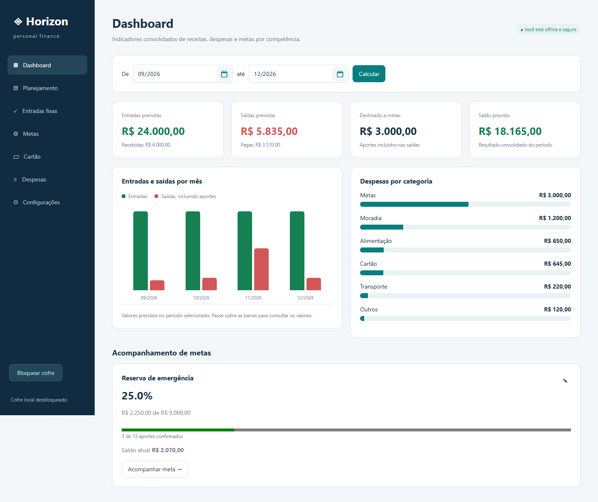
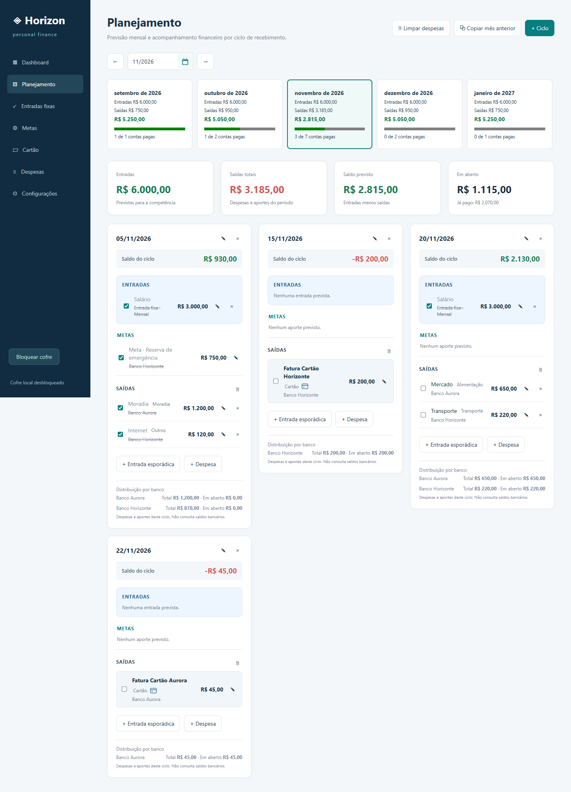
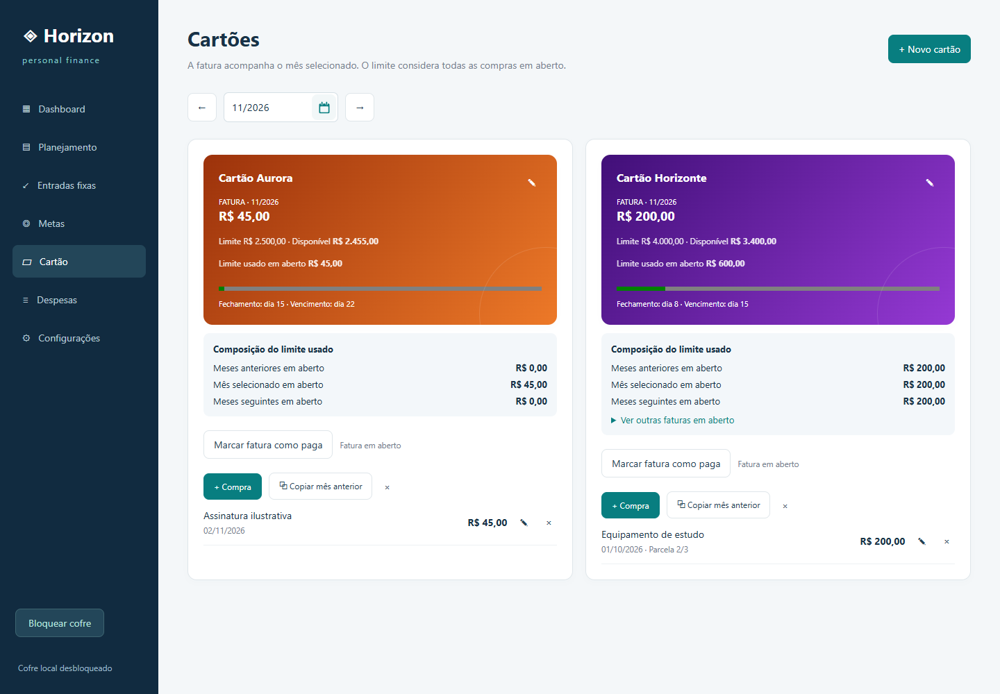
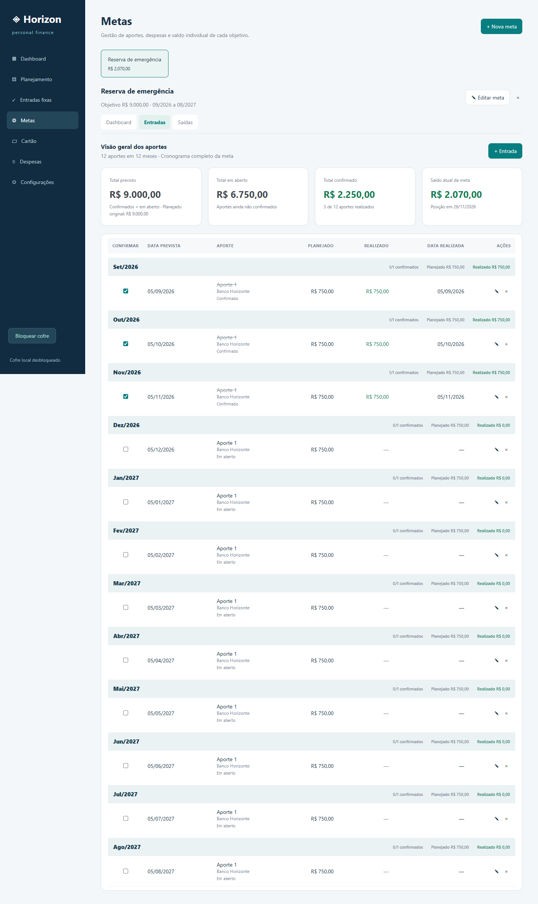

<p align="center"></p>

# Horizon — personal finance

Um app de finanças pessoais para organizar o mês, acompanhar cartões e tirar metas do papel. Os dados ficam no computador, em um cofre SQLite criptografado com senha.

Criei o Horizon a partir de uma necessidade do dia a dia: enxergar quanto entra, o que precisa ser pago em cada data e quanto posso separar para os meus objetivos. O projeto evoluiu de uma ferramenta local para este aplicativo desktop, desenvolvido de forma iterativa com apoio do CODEX.

**Windows x64 · Português brasileiro · Sem cadastro · Funciona offline**



## Quero usar

Baixe o arquivo **Horizon-v1.0.0-windows-x64.zip** na seção **Releases** deste repositório, quando a versão estiver publicada.

1. Extraia o ZIP inteiro para uma pasta.
2. Abra **Horizon.exe**. Não mova apenas o executável.
3. Crie uma senha com pelo menos 12 caracteres e confirme o aviso sobre recuperação.
4. Cadastre suas entradas, despesas, cartões e metas. O cofre começa vazio.

Não precisa instalar Node, Python ou um servidor para usar o download pronto. O aplicativo não possui assinatura digital; o Windows pode exibir um aviso de editor desconhecido. Não é necessário desativar o antivírus.

## O que ele faz

| Área           | Recursos                                                                                                                           |
| -------------- | ---------------------------------------------------------------------------------------------------------------------------------- |
| Dashboard      | Entradas e saídas por período, saldo previsto, gráfico com valores ao passar o mouse e distribuição por categoria.                 |
| Planejamento   | Organização por mês e ciclo de recebimento, confirmação de pagamentos, despesas avulsas, recorrências e resumo por banco.          |
| Entradas fixas | Fontes recorrentes de receita, com distribuição por dias de recebimento e geração automática no planejamento.                      |
| Metas          | Entradas, saídas, saldo por data, visão geral e cronograma completo agrupado por mês.                                              |
| Cartões        | Limites, faturas por competência, compras à vista e parceladas, reserva do crédito de parcelas futuras e liberação após pagamento. |
| Despesas       | Biblioteca de despesas e recorrências com vigência. Exclusão de uma ocorrência, de um período ou da série, após revisão.           |
| Configurações  | Bancos com padrão para novos registros, categorias ordenáveis por arraste ou A–Z/Z–A, backups e senha.                             |

Os bancos são etiquetas para organizar pagamentos e separar transferências. Não há conexão com contas bancárias nem transferências automáticas. As saídas de uma meta usam o orçamento próprio desse objetivo e não duplicam despesas no planejamento geral.

Nos aportes, o **total previsto** soma os valores confirmados aos ainda em aberto. O planejamento original fica indicado separadamente, pois um aporte pode ser realizado com valor diferente do previsto.

## Telas

Todas as imagens abaixo usam **dados fictícios criados para demonstração**. Nenhuma delas é uma captura do cofre pessoal do autor.







## Privacidade e cuidados com o cofre

- Os registros ficam em `%LOCALAPPDATA%/HorizonPersonalFinance/dados/horizon.sqlite.enc`.
- O cofre usa SQLite3 Multiple Ciphers em configuração SQLCipher, AES-256 e derivação de chave com PBKDF2. A senha não fica salva no código.
- O aplicativo bloqueia o cofre após cinco minutos sem interação e ao suspender ou bloquear o Windows.
- Backups criptografados podem ser criados em Configurações. Guarde cópias fora do computador.
- Sem a senha, não existe recuperação. Backups antigos continuam exigindo a senha usada na data de criação.
- A criptografia protege o arquivo em repouso. Com o cofre aberto, os dados estão na memória do processo. Ela não substitui a segurança do sistema operacional.

O projeto não passou por uma auditoria independente de segurança. Consulte [SECURITY.md](SECURITY.md) para limitações e como relatar um problema sem expor seus dados.

## Rodar pelo código

Requisitos: **Windows x64, Node.js 24 e npm**. A conexão com a internet é necessária para baixar as dependências na primeira preparação.

```sh
npm ci
npm run setup
npm start
```

A configuração `.npmrc` desativa scripts automáticos de dependências. O comando `setup` instala explicitamente o runtime Electron e verifica o SQLite nativo já distribuído pela dependência, evitando uma compilação C++ desnecessária.

### Verificar e empacotar

```sh
npm run check:privacy
npm test
npm run test:ui
npm run package
```

O build fica em `release/Horizon-win32-x64`. Testes usam cofres temporários e dados sintéticos. Nunca usam um cofre pessoal.

## Estrutura

```text
src/       Processo principal, ponte IPC e persistência criptografada
ui/        Interface, estilos, ícones e regras de apresentação
tests/     Testes do cofre e da interface com dados sintéticos
scripts/   Preparação, empacotamento e verificação de privacidade
docs/      Arquitetura, guia de uso e imagens de demonstração
.github/   Verificações automatizadas para Windows
```

O frontend usa HTML, CSS e JavaScript, sem framework. O desktop é Electron e o banco é SQLite com criptografia. Veja [a arquitetura](docs/ARQUITETURA.md) e [o guia de uso](docs/GUIA-DE-USO.md).

## Desenvolvimento e licença

Contribuições são bem-vindas. Veja [CONTRIBUTING.md](CONTRIBUTING.md). Esta primeira versão pública é voltada a Windows x64; Linux, macOS, sincronização, juros automáticos, integração bancária e atualização automática não estão incluídos.

Código do projeto sob a [licença MIT](LICENSE). Electron, SQLite3 Multiple Ciphers e demais dependências mantêm suas próprias licenças.
