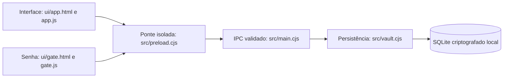

# Arquitetura

O Horizon é um aplicativo Electron. A interface usa HTML, CSS e JavaScript; o processo principal concentra acesso a arquivos, diálogos e ao cofre.

## Processo principal

`src/main.cjs` cria a janela, define a política de navegação e registra os canais IPC. Os pedidos são aceitos somente da janela principal e de páginas locais autorizadas. Há operações distintas para a tela de senha e para o cofre aberto.

O bloqueio fecha o banco e substitui a página de finanças pela tela de senha. Um contador de sessão impede concluir uma importação ou backup pendente após o bloqueio. Erros de autenticação têm espera progressiva entre tentativas.

## Ponte e interface

`src/preload.cjs` expõe uma API pequena em `window.horizon`: abrir/criar, ler, salvar, importar, restaurar, fazer backup, trocar senha e bloquear. O renderer não recebe acesso geral a arquivos ou a módulos Node.

`ui/app.js` reúne o estado da tela e as regras de negócio. Os grupos principais são:

| Funções                             | Responsabilidade                                                          |
| ----------------------------------- | ------------------------------------------------------------------------- |
| `loadState`, `save`, `render`       | Carregar o estado, persistir uma revisão e atualizar a tela.              |
| `entries`, `stats`, `planning`      | Consolidar entradas, despesas, faturas e aportes por competência e ciclo. |
| `salaryEntries`, `planningIncome`   | Projetar recebimentos recorrentes e vincular registros existentes.        |
| `expenseSeries`, `expenseRows`      | Gerar ocorrências mensais dentro da vigência e respeitar exclusões.       |
| `startExpenseDelete`                | Revisar o alcance da exclusão antes de uma gravação com backup.           |
| `invoiceInfo`, `bills`              | Gerar os totais de faturas e sua representação no planejamento.           |
| `installmentRows`, `purchaseForm`   | Dividir compras em parcelas e preservar os centavos.                      |
| `goalPosition`, `goalIncomeTotals`  | Apurar saldo por data, valores realizados e previsão de aportes.          |
| `cycleBanks`, `bankForm`            | Agrupar compromissos por banco e manter o cadastro visual.                |
| `orderedCategories`, `moveCategory` | Ordenar categorias alfabeticamente ou pela ordem personalizada.           |

As recorrências podem ser virtuais até serem editadas ou confirmadas. As escolhas de exclusão são registradas para evitar que a projeção recrie uma ocorrência removida. Compras parceladas comprometem o limite pelo saldo não pago, incluindo parcelas futuras.

## Persistência

`src/vault.cjs` fornece:

- `empty`: estado inicial sem lançamentos.
- `validate`: validação de estrutura, identificadores e limite de tamanho.
- `Vault.create/unlock/lock`: ciclo de abertura do cofre.
- `Vault.read/save`: leitura e gravação transacional com revisão SHA-256.
- `Vault.backup/restore`: cópias criptografadas.
- `Vault.changePassword`: mudança de senha, preservando uma cópia anterior.
- `readImport`: leitura de backup JSON ou banco de uma edição anterior.

O banco mantém o estado financeiro serializado, não uma tabela relacional por entidade. As coleções centrais são `cycles`, `entries`, `templates`, `cards`, `purchases`, `goals`, `contributions`, `withdrawals` e `categories`. Bancos e definições de recorrência são campos adicionais do estado.

Valores monetários usam arredondamento para centavos nos totais e na divisão de parcelas. A interface distingue valor planejado de valor realizado.

## Testes e distribuição

`tests/core.cjs` verifica o cofre com registros sintéticos, autenticação, persistência, backups, importações e corrupção. `tests/public-ui.cjs` abre uma instância temporária do Electron e verifica o primeiro uso sem importação e os fluxos essenciais. `scripts/screenshots.cjs` gera as capturas de divulgação com dados fictícios usando o Microsoft Edge em modo headless.

`scripts/check-privacy.cjs` procura arquivos e padrões que não devem ir para o Git. Essa verificação é uma proteção adicional, não uma auditoria completa de segredos.

`scripts/package.cjs` gera a versão Windows x64. A edição pública usa `HorizonPersonalFinance` como diretório de dados; não procura nem abre automaticamente o cofre de uma instalação pessoal anterior.
